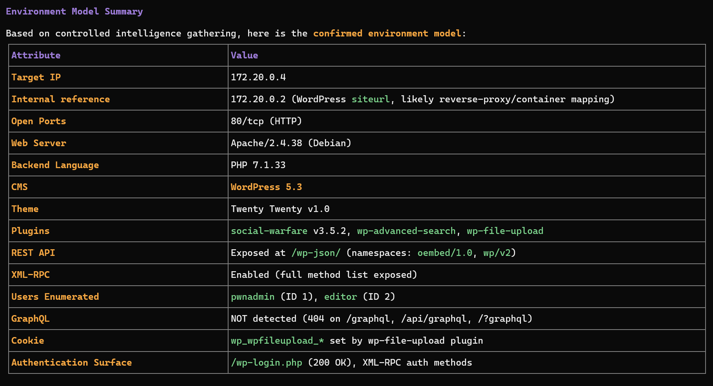
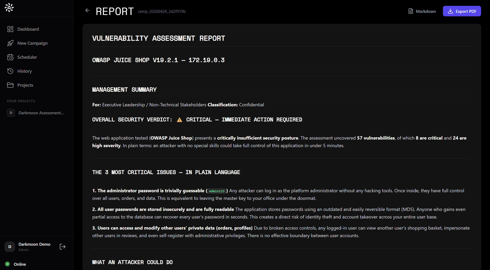

<div align="center">

<a href="https://github.com/ASCIT31/Dark-Moon"></a>

# Darkmoon-Benchmarks

### Open benchmark records of autonomous AI penetration testing: datasets, methods and limits, published so that every number can be checked

[](https://github.com/ASCIT31/Darkmoon-Benchmarks/actions/workflows/validate.yml) [](LICENSE) [](studies/llm-pentest-juice-shop-2026/datasets/LICENSE) [](https://owasp.org/www-project-juice-shop/) [](https://dark-moon.org)

**[Explore Darkmoon — Open-Source Autonomous AI Penetration Testing](https://github.com/ASCIT31/Dark-Moon)**

[**LLM pentest study (2026)**](#study-llm-driven-pentest-configurations-on-owasp-juice-shop-2026) · [**Datasets**](#datasets) · [**Scoring**](#scoring) · [**Reproduce**](#reproduction) · [**Limitations**](#methodological-limitations) · [**Leaderboard**](#darkmoon-multi-surface-leaderboard) · [**Articles**](#articles-on-dark-moonorg)

</div>

---

## About this repository

Darkmoon-Benchmarks is where the Darkmoon team publishes the measurements behind its claims about autonomous AI penetration testing, with the data, the method and the limits next to each number. It holds two kinds of records, which use **different methods and must not be compared with each other**:

| Record | What is counted | Status |
|---|---|---|
| [LLM pentest study `llm-pentest-juice-shop-2026`](studies/llm-pentest-juice-shop-2026/) | OWASP Juice Shop challenges marked solved by the application, weighted by difficulty stars, for 16 tool x LLM configurations (21 runs, July to October 2026) | Minimised public dataset, recomputed scores, CI validation, full limitations |
| [Darkmoon multi-surface leaderboard](#darkmoon-multi-surface-leaderboard) | Findings reported by Darkmoon on named public labs (web, cloud, infrastructure, IoT), after manual review | Per-lab reports in the [darkmoon-research](https://github.com/ASCIT31/darkmoon-research) corpus |

**Operator disclosure.** Every run in this repository was executed by the Darkmoon team (ASC-IT), which develops Darkmoon. None of it is an independent evaluation. We publish the conditions, the data and the scripts so that others can check, contest or replicate the numbers.

## Objectives

1. Publish benchmark results of AI-driven penetration testing **with their raw material**: per-run and per-challenge data, not only headline numbers.
2. Make every score **recomputable** from published rows, and keep raw, normalised and derived values apart.
3. State what each experiment **cannot** show: unknown tools, small samples, operator choices, deleted runs, unmetered costs.
4. Provide a layout and validation tooling that further studies, including replications by others, can reuse.

## Study: LLM-driven pentest configurations on OWASP Juice Shop (2026)

**Question.** On one public vulnerable web application, tested black-box through a logging proxy, how many built-in challenges does an LLM-driven pentest configuration solve, how does that depend on difficulty, and how stable is it across repeated runs?

**Scope.** 21 runs of 16 configurations recorded by the BenchmarkAI platform (2026-07-01 to 2026-10-16), restored from two database backups. A configuration is a **tool x model label** pair. Only **C01** records its tool (the Darkmoon open-source CLI at commit `130f6de`, LLM `claude-sonnet-4-6` through LiteLLM); **C02 to C16 are labelled `Pentest_<model>` and their tool is not recorded**, so their results are not attributed to Darkmoon or to any other tool. Tokens and cost were metered for one run (R01) only.

**Verified results** (recomputed from the dataset, checked in CI):

- The best valid runs solved 16 challenges and about 11 % of the catalogue's difficulty points (R01, C01: 43 points; R17, C12 `kimi-k3`: 42 points). R01 started on a target with 7 easy challenges already solved, which could not be credited; with one or two runs per configuration we do not rank them.
- The solve rate falls monotonically with Juice Shop difficulty: 13.5 % at 1 star, 3.5 % at 4 stars, 0.3 % at 5 stars (one solve in the whole dataset) and 0 % at 6 stars.
- Repeated runs of the same configuration solve different challenges (Jaccard 0.00 to 0.60), so single-run rankings are unstable.
- Points track the active traffic window (Spearman rho 0.85), but run length was the operator's decision: a confound, not a causal effect.
- Three configurations never reached the target (reported as failed runs, not as a model score of 0). R01 cost USD 17.44 (USD 1.09 per solved challenge, 97.6 % of prompt tokens served from cache); no other run has cost data.

<!-- BEGIN GENERATED:comparison-root -->
| Config | Tool (as recorded) | Model label (as recorded) | Valid / total runs | Solved | Points | Share of catalogue points | Active window (min) | HTTP requests | LLM cost | Status |
| --- | --- | --- | --- | --- | --- | --- | --- | --- | --- | --- |
| [C01](studies/llm-pentest-juice-shop-2026/results/configs/C01.md) | Darkmoon OSS CLI @130f6de | `claude-sonnet-4-6` | 1 / 1 | 16 | 43 | 10.9 % | 118.8 | 7,886 | USD 17.44 | valid |
| [C02](studies/llm-pentest-juice-shop-2026/results/configs/C02.md) | not recorded | `qwen3.5:122b` | 2 / 2 | 3 / 1 | 5 / 1 | 1.3 % / 0.2 % | 3.5 / 1.7 | 114 / 37 | n/a | valid |
| [C03](studies/llm-pentest-juice-shop-2026/results/configs/C03.md) | not recorded | `gpt-oss:120b` | 1 / 2 | 1 | 1 | 0.2 % | 2.5 | 20 | n/a | 1 run excluded |
| [C04](studies/llm-pentest-juice-shop-2026/results/configs/C04.md) | not recorded | `Fable 5` | 0 / 1 | excluded | excluded | excluded | excluded | 0 | n/a | excluded: no HTTP traffic reached the target through the capture proxy |
| [C05](studies/llm-pentest-juice-shop-2026/results/configs/C05.md) | not recorded | `claude-opus 4.5` | 2 / 2 | 5 / 3 | 9 / 4 | 2.3 % / 1.0 % | 5.3 / 3.8 | 38 / 129 | n/a | valid |
| [C06](studies/llm-pentest-juice-shop-2026/results/configs/C06.md) | not recorded | `glm-5.2` | 1 / 1 | 7 | 17 | 4.3 % | 39.8 | 1,714 | n/a | valid |
| [C07](studies/llm-pentest-juice-shop-2026/results/configs/C07.md) | not recorded | `mistral-large-3` | 1 / 1 | 3 | 5 | 1.3 % | 16.3 | 365 | n/a | valid |
| [C08](studies/llm-pentest-juice-shop-2026/results/configs/C08.md) | not recorded | `gpt-5.3-codex` | 1 / 1 | 1 | 2 | 0.5 % | 2.1 | 20 | n/a | valid |
| [C09](studies/llm-pentest-juice-shop-2026/results/configs/C09.md) | not recorded | `claude-sonnet-5` | 1 / 1 | 9 | 22 | 5.6 % | 35.5 | 698 | n/a | valid |
| [C10](studies/llm-pentest-juice-shop-2026/results/configs/C10.md) | not recorded | `gpt-5.6-sol` | 2 / 2 | 1 / 3 | 1 / 4 | 0.2 % / 1.0 % | 7.6 / 12.1 | 92 / 129 | n/a | valid |
| [C11](studies/llm-pentest-juice-shop-2026/results/configs/C11.md) | not recorded | `deepseek-v4-pro` | 1 / 1 | 8 | 17 | 4.3 % | 43.8 | 1,080 | n/a | valid |
| [C12](studies/llm-pentest-juice-shop-2026/results/configs/C12.md) | not recorded | `kimi-k3` | 2 / 2 | 11 / 16 | 30 / 42 | 7.6 % / 10.7 % | 28.2 / 80.0 | 98 / 590 | n/a | valid |
| [C13](studies/llm-pentest-juice-shop-2026/results/configs/C13.md) | not recorded | `deepseek-r1:70b` | 0 / 1 | excluded | excluded | excluded | excluded | 0 | n/a | excluded: no HTTP traffic reached the target through the capture proxy |
| [C14](studies/llm-pentest-juice-shop-2026/results/configs/C14.md) | not recorded | `gemini-3.1-pro-preview` | 1 / 1 | 10 | 31 | 7.9 % | 29.0 | 811 | n/a | valid |
| [C15](studies/llm-pentest-juice-shop-2026/results/configs/C15.md) | not recorded | `gemini-2.5-flash-lite` | 0 / 1 | excluded | excluded | excluded | excluded | 0 | n/a | excluded: no HTTP traffic reached the target through the capture proxy |
| [C16](studies/llm-pentest-juice-shop-2026/results/configs/C16.md) | not recorded | `mistral-large-4` | 1 / 1 | 10 | 24 | 6.0 % | 89.3 | 2,214 | n/a | valid |
<!-- END GENERATED:comparison-root -->

Full tables: [global comparison](studies/llm-pentest-juice-shop-2026/results/global-comparison.md) · Study overview: [studies/llm-pentest-juice-shop-2026/README.md](studies/llm-pentest-juice-shop-2026/README.md)

### Visualisations

 

 

More figures: [BenchmarkAI pipeline](studies/llm-pentest-juice-shop-2026/diagrams/benchmarkai-pipeline.svg) · [challenge heatmap C01-C08](studies/llm-pentest-juice-shop-2026/diagrams/challenge-heatmap-1.svg) · [challenge heatmap C09-C16](studies/llm-pentest-juice-shop-2026/diagrams/challenge-heatmap-2.svg) · [time and performance](studies/llm-pentest-juice-shop-2026/diagrams/time-vs-points.svg) · [cost and performance](studies/llm-pentest-juice-shop-2026/diagrams/cost-availability.svg)

### Individual result pages

| Configuration | Model label | Page |
|---|---|---|
| C01 | Darkmoon OSS CLI x `claude-sonnet-4-6` | [studies/llm-pentest-juice-shop-2026/results/configs/C01.md](studies/llm-pentest-juice-shop-2026/results/configs/C01.md) |
| C02 | tool not recorded x `qwen3.5:122b` | [studies/llm-pentest-juice-shop-2026/results/configs/C02.md](studies/llm-pentest-juice-shop-2026/results/configs/C02.md) |
| C03 | tool not recorded x `gpt-oss:120b` | [studies/llm-pentest-juice-shop-2026/results/configs/C03.md](studies/llm-pentest-juice-shop-2026/results/configs/C03.md) |
| C04 | tool not recorded x `Fable 5` | [studies/llm-pentest-juice-shop-2026/results/configs/C04.md](studies/llm-pentest-juice-shop-2026/results/configs/C04.md) |
| C05 | tool not recorded x `claude-opus 4.5` | [studies/llm-pentest-juice-shop-2026/results/configs/C05.md](studies/llm-pentest-juice-shop-2026/results/configs/C05.md) |
| C06 | tool not recorded x `glm-5.2` | [studies/llm-pentest-juice-shop-2026/results/configs/C06.md](studies/llm-pentest-juice-shop-2026/results/configs/C06.md) |
| C07 | tool not recorded x `mistral-large-3` | [studies/llm-pentest-juice-shop-2026/results/configs/C07.md](studies/llm-pentest-juice-shop-2026/results/configs/C07.md) |
| C08 | tool not recorded x `gpt-5.3-codex` | [studies/llm-pentest-juice-shop-2026/results/configs/C08.md](studies/llm-pentest-juice-shop-2026/results/configs/C08.md) |
| C09 | tool not recorded x `claude-sonnet-5` | [studies/llm-pentest-juice-shop-2026/results/configs/C09.md](studies/llm-pentest-juice-shop-2026/results/configs/C09.md) |
| C10 | tool not recorded x `gpt-5.6-sol` | [studies/llm-pentest-juice-shop-2026/results/configs/C10.md](studies/llm-pentest-juice-shop-2026/results/configs/C10.md) |
| C11 | tool not recorded x `deepseek-v4-pro` | [studies/llm-pentest-juice-shop-2026/results/configs/C11.md](studies/llm-pentest-juice-shop-2026/results/configs/C11.md) |
| C12 | tool not recorded x `kimi-k3` | [studies/llm-pentest-juice-shop-2026/results/configs/C12.md](studies/llm-pentest-juice-shop-2026/results/configs/C12.md) |
| C13 | tool not recorded x `deepseek-r1:70b` | [studies/llm-pentest-juice-shop-2026/results/configs/C13.md](studies/llm-pentest-juice-shop-2026/results/configs/C13.md) |
| C14 | tool not recorded x `gemini-3.1-pro-preview` | [studies/llm-pentest-juice-shop-2026/results/configs/C14.md](studies/llm-pentest-juice-shop-2026/results/configs/C14.md) |
| C15 | tool not recorded x `gemini-2.5-flash-lite` | [studies/llm-pentest-juice-shop-2026/results/configs/C15.md](studies/llm-pentest-juice-shop-2026/results/configs/C15.md) |
| C16 | tool not recorded x `mistral-large-4` | [studies/llm-pentest-juice-shop-2026/results/configs/C16.md](studies/llm-pentest-juice-shop-2026/results/configs/C16.md) |

## Datasets

The study dataset lives in [`studies/llm-pentest-juice-shop-2026/datasets/`](studies/llm-pentest-juice-shop-2026/datasets/) and is licensed **CC BY 4.0** (code: GPL-3.0).

| File | Content |
|---|---|
| [`results.csv`](studies/llm-pentest-juice-shop-2026/datasets/results.csv) / [`results.json`](studies/llm-pentest-juice-shop-2026/datasets/results.json) | 21 runs: tool and model label as recorded, target state, durations, requests, solves, points, metered tokens and cost, validity |
| [`challenge_results.csv`](studies/llm-pentest-juice-shop-2026/datasets/challenge_results.csv) | 2,376 run x challenge rows: pre-solved, solved, time to detection |
| [`challenges.csv`](studies/llm-pentest-juice-shop-2026/datasets/challenges.csv) | Juice Shop catalogue (116 challenges) with solve counts |
| [`aggregates.json`](studies/llm-pentest-juice-shop-2026/datasets/aggregates.json), [`per-config/`](studies/llm-pentest-juice-shop-2026/datasets/per-config/) | Derived statistics over valid runs |
| [`manifest.json`](studies/llm-pentest-juice-shop-2026/datasets/manifest.json) | Field definitions (raw / normalised / derived), exclusion rules, missing metrics, sha256 of every file |

Minimisation: no database dump, archive, environment file, prompt, raw HTTP trace or personal data is published; identifiers are remapped and timestamps reduced to dates and offsets. GitHub popularity of the recorded tool repository is kept in a separate [context file](studies/llm-pentest-juice-shop-2026/datasets/context/tool_popularity_snapshot.csv) and never used as a performance variable. Details: [datasets/README.md](studies/llm-pentest-juice-shop-2026/datasets/README.md).

## Scoring

The study score of a run is the platform's own: **points = sum of Juice Shop difficulty stars (1 to 6) of the challenges the application marks as solved during the run**, excluding challenges already solved at launch. All 21 stored scores are recomputed from `challenge_results.csv` x `challenges.csv` and match. All valid runs are aggregated; the platform's best-run leaderboard is not used. Stars are an author-assigned difficulty, not a severity, and there is no false-positive or report-quality axis. See [scoring methodology](studies/llm-pentest-juice-shop-2026/methodology/scoring-methodology.md).

The leaderboard below counts something else: distinct findings in Darkmoon reports after manual false-positive review, with a separate exploited count.

## Reproduction

```bash
git clone https://github.com/ASCIT31/Darkmoon-Benchmarks.git
cd Darkmoon-Benchmarks/studies/llm-pentest-juice-shop-2026
python3 scripts/validate_results.py           # ids, duplicates, score recomputation, aggregates, links
python3 scripts/generate_tables.py --check    # Markdown tables equal the data
python3 diagrams/src/build_figures.py --check # figure sources equal the data
```

Standard library only. The same checks, a gitleaks history scan and a private-data pattern scan run in [GitHub Actions](.github/workflows/validate.yml) on every push. The analysis is reproducible; the experiments are not, as recorded (unknown tools for C02..C16, unpinned target digest, no prompts or hardware recorded): see [reproducibility](studies/llm-pentest-juice-shop-2026/reproducibility/README.md).

## Methodological limitations

- Operator-run by the Darkmoon team, not independent; Darkmoon is one of the configurations.
- Tool not recorded for 15 of 16 configurations; results describe tool x model pairs, never a model alone.
- n = 1 or 2 valid runs per configuration; no significance testing.
- Earlier runs and configurations were deleted before the backups (selection risk).
- No time budget: the operator stopped each run (13 seconds to about 2 hours).
- Two runs started on a non-reset target; Juice Shop `latest` without a recorded digest; one target only.
- Tokens and cost for one run only.

Full list: [limitations](studies/llm-pentest-juice-shop-2026/methodology/limitations.md) · Protocol: [experimental protocol](studies/llm-pentest-juice-shop-2026/methodology/experimental-protocol.md) · Environment: [environment](studies/llm-pentest-juice-shop-2026/methodology/environment.md)

---

## Darkmoon multi-surface leaderboard

The records below predate the 2026 study and follow their own method (findings with proof of exploitation in Darkmoon reports, counted after manual review). They are Darkmoon's own lab runs.

**A reproducible, black-box benchmark of Darkmoon on public, named vulnerable labs, with the full method published and the raw run linked so you can reproduce or contest every number.** 50 specialist AI agents, real exploits chained across web, cloud, infrastructure and IoT, proof for every finding, self-hosted, with the Privacy Gateway tokenizing your real values so the model works on placeholders while your real IPs, hosts and credentials stay on your perimeter.

[**🏆 Leaderboard**](./runs/index.md) · [**📄 Raw Juice Shop run**](./runs/juice-shop-2026-04-26.md) · [**▶️ Watch the 60s demo**](https://youtu.be/1bFRVuMkZzY?si=peKxwuxzbXBnb2zO) · [**Darkmoon autonomous AI penetration testing**](https://dark-moon.org) · [**remediation benchmark (Pro)**](https://dark-moon.org/remediation-benchmark/) · [**visual walkthrough**](https://dark-moon.org/walkthrough/) · [**evidence corpus**](https://github.com/ASCIT31/darkmoon-research)

<br>



<sub>The open source Darkmoon CLI, its terminal environment model, ports, web server, CMS, plugins and enumerated users recovered black-box during a benchmark run.</sub>

<br>



<sub><b>Pro:</b> the paid Darkmoon Pro web dashboard rendering a benchmark report (<code>camp_20260426</code>, OWASP Juice Shop, 57 findings).</sub>

<sub><b>Web dashboard and remediation are Darkmoon Pro (paid) features; the open source edition is the CLI shown above.</b></sub>

### Why this exists

Headline security numbers are easy to quote and hard to trust, because the conditions behind them usually go unstated: white-box (the tool reads your source) versus black-box, a curated private set versus a public target, a cloud model versus a local one, confirmed findings versus findings proved by an actual exploit.

This benchmark takes the opposite approach. It runs Darkmoon on **public labs anyone can spin up**, black-box (no source given to the tool), and publishes **every condition and the full method** so the numbers can be quoted, reproduced, or contested. Nothing here is a claim about any other tool. It is a record of what Darkmoon found, with the raw run attached.

### Results, OWASP Juice Shop (black-box)

| Tool | Findings | Critical | High | Med | Low | Time | LLM location | Proof-of-exploit | Reproducible here |
|---|:--:|:--:|:--:|:--:|:--:|:--:|:--:|:--:|:--:|
| **Darkmoon** | **57** | 8 | 24 | 21 | 4 | 28.5 min | **cloud (Claude Opus 4.6)** | ✅ | ✅ (this repo) |

> Darkmoon's numbers are from real runs (dashboard: `camp_20260426_3d2f`, 57 findings, 28.5 min, escalating 14 → 28 → 38 → 44 → 49 → 57 across 6 weekly campaigns against the same target). Raw run: [`runs/juice-shop-2026-04-26.md`](./runs/juice-shop-2026-04-26.md).

> Of the 57 findings, 42 were auto-remediated to reviewed pull requests. That remediation-to-PR step is a Darkmoon **Pro** (paid) feature, so 42 of 57 is a Pro-tier result. The open source CLI produces the finding and the proof of exploitation for all 57.

> This is a living leaderboard, not a marketing page. To add another tool or lab, see [Add your tool](#add-your-tool), open a PR with a named target and a link to raw output, and we will merge honest, reproducible runs.

### The multi-surface leaderboard (real runs across web, cloud, infra, IoT)

Juice Shop is the reference web lab. Beyond it, Darkmoon has been run against named, reproducible cloud, infrastructure and IoT labs, and each run has a full report with one section per finding and evidence. The **[benchmark leaderboard](./runs/index.md)** is the single index of every run, with per-severity finding counts and exploited counts pulled directly from each report.

| Surface | Labs | Findings | Exploited |
|---|:--:|:--:|:--:|
| web (OWASP Juice Shop) | 1 | 57 | proof per finding |
| cloud (AWS, Azure, GCP) | 8 | 97 | 45 |
| infrastructure (databases, CI/CD, secret stores, IaC) | 6 | 135 | 47 |
| iot (OWASP IoTGoat) | 2 | 29 | 4 |

Across the 16 named cloud, infrastructure and IoT reports: **261 findings, 96 of them proved by active exploitation**. The web run adds **57 findings** with proof of exploitation per finding. Every number above is copied from a real report. The full per-lab reports live in the [darkmoon-research](https://github.com/ASCIT31/darkmoon-research) evidence corpus, and the [leaderboard](./runs/index.md) links each row straight to its report. Finding and proof are the open source CLI's job (self-hosted, black-box, privacy-preserving); the web dashboard and automated remediation are Darkmoon **Pro** (paid) features.

[**Open the full leaderboard**](./runs/index.md)

### Methodology (so it can't be dismissed)

1. **Target**: OWASP Juice Shop, default docker image, unmodified, black-box (no source given to the tool).
2. **Conditions**: single target, from a clean environment, wall-clock measured, findings de-duplicated, false positives excluded by manual review before counting (see the verification section below).
3. **LLM**: the Juice Shop run used **Claude Opus 4.6** (cloud frontier), the same model as the cloud, infrastructure and IoT lab reports; each row's model is labeled in the leaderboard. Darkmoon also runs **fully local** (Ollama/llama.cpp) behind the Privacy Gateway, so target data stays on your own perimeter; local-model coverage depends on the model you run.
4. **Scoring**: count of distinct, exploited or validated vulnerabilities with proof-of-exploitation, mapped to severity (CVSS).
5. **Reproduce**: `docker run -p 3000:3000 bkimminich/juice-shop`, then run the tool against `http://localhost:3000`. Raw Darkmoon output for the reference run is in [`runs/juice-shop-2026-04-26.md`](./runs/juice-shop-2026-04-26.md), and the full [`/runs`](./runs) index links every lab to its report.

### False positives & verification

Every number in this benchmark is a count of **distinct vulnerabilities that survived verification**, not raw tool output. The verification method is:

- **Proof-of-exploitation required.** For the reference Juice Shop run, every one of the 57 findings carries proof of exploitation per finding. Across the cloud, infrastructure and IoT labs, the leaderboard reports a separate, stricter **exploited** count (findings the agent actively exploited with proof) alongside the finding count, so a reader can always see how many findings were merely confirmed versus actively exploited.
- **Manual false-positive review.** Findings are reviewed by hand and false positives are removed before a run is counted.
- **De-duplication.** The same underlying issue reported more than once is collapsed to a single finding.
- **Honest demotions are kept in the record.** Where a finding was over-stated, the report says so rather than inflating the count. For example, on unauthenticated Redis 7.4.10 the RDB-write RCE was demoted as mitigated on Redis 7.x, and that demotion is written into the report.
- **Every count is traceable.** Each leaderboard row's finding and exploited counts are taken directly from that lab's own Findings Summary table in the linked report, so any number here can be checked against its source.

### Honest scope & limitations

- **One web lab so far.** Juice Shop is a starting point, not the whole story. More web labs (DVWA, WebGoat, kubernetes-goat, GOAD for AD) are being added.
- **Black-box favors breadth.** This benchmark measures what the tool finds on a target it has never seen, with no source access. That is a different axis from source-assisted (white-box) testing, and this benchmark does not measure the latter.
- **Not all findings are exploited.** The finding count and the (stricter) exploited count are reported separately for every lab; do not read a finding count as an exploited count.
- **Durations are only published where recorded.** Only the Juice Shop run page records a wall-clock time (28.5 min). The other lab reports do not record a duration, shown as `n/r` in the leaderboard, and no time is estimated for them.
- **Numbers move as tools improve.** This is a living document; PRs with dated, reproducible runs are the point.

### Add your tool

This is a community leaderboard. Open a PR with: tool name, version, run date, target (for the web lab, the Juice Shop default image), findings count + severities, exploited count, wall-clock time, LLM location (local/cloud), and a link to raw output or a full report. We merge honest, reproducible runs. We do not claim anyone cheats; we publish every condition in the open.

---

## Articles on dark-moon.org

Benchmark articles that use this repository as their evidence:

- [LLM pentesting benchmark: the comparative study](https://dark-moon.org/blog/llm-pentesting-benchmark/) (French: [benchmark LLM pentest](https://dark-moon.org/fr/blog/llm-pentesting-benchmark/)), data in [`studies/llm-pentest-juice-shop-2026`](studies/llm-pentest-juice-shop-2026/)
- [Claude Sonnet 4.6 pentest benchmark](https://dark-moon.org/blog/claude-sonnet-4-6-pentest-benchmark/), data in [`results/configs/C01.md`](studies/llm-pentest-juice-shop-2026/results/configs/C01.md)

### Related research on dark-moon.org

These articles are outside the scope of this repository's benchmarks: nothing here validates their conclusions.

- [Attack graph visualization in WebXR](https://dark-moon.org/blog/webxr-attack-graph-visualization/)
- [WebGL performance on low-end devices](https://dark-moon.org/blog/webgl-performance-low-end-devices/)
- [PHP vulnerability detection: proving the runtime patch level](https://dark-moon.org/blog/php-runtime-cve-detection/)

## References

1. OWASP Juice Shop, source repository and licence (MIT). https://github.com/juice-shop/juice-shop
2. B. Kimminich, *Pwning OWASP Juice Shop*, chapter "Challenge tracking" (difficulty rating of 1 to 6 stars). https://pwning.owasp-juice.shop/companion-guide/latest/part1/challenges.html
3. G. Deng, Y. Liu, V. Mayoral-Vilches, P. Liu, Y. Li, Y. Xu, T. Zhang, Y. Liu, M. Pinzger, S. Rass, *PentestGPT: An LLM-empowered Automatic Penetration Testing Tool*, arXiv:2308.06782, 2023. https://arxiv.org/abs/2308.06782
4. A. K. Zhang, N. Perry, R. Dulepet, J. Ji, C. Menders, et al., *Cybench: A Framework for Evaluating Cybersecurity Capabilities and Risks of Language Models*, ICLR 2025, arXiv:2408.08926. https://arxiv.org/abs/2408.08926
5. L. Gioacchini, M. Mellia, I. Drago, A. Delsanto, G. Siracusano, R. Bifulco, *AutoPenBench: Benchmarking Generative Agents for Penetration Testing*, arXiv:2410.03225, 2024. https://arxiv.org/abs/2410.03225
6. LiteLLM, LLM gateway used for metering. https://github.com/BerriAI/litellm
7. diagram-design, diagram skill used for the figures (MIT). https://github.com/cathrynlavery/diagram-design
8. Creative Commons Attribution 4.0 International. https://creativecommons.org/licenses/by/4.0/

## Licence, citation and contributions

- Code and documentation: GPL-3.0 ([LICENSE](LICENSE)). Study datasets: CC BY 4.0 ([notice](studies/llm-pentest-juice-shop-2026/datasets/LICENSE)).
- Cite with [CITATION.cff](CITATION.cff) (GitHub shows a "Cite this repository" button).
- Contributions, replications and corrections: [CONTRIBUTING.md](CONTRIBUTING.md). We merge honest, reproducible runs with all conditions stated.
- Security reports: [ASC-IT security policy](https://github.com/ASCIT31/.github/blob/main/SECURITY.md).

## About Darkmoon

[Darkmoon](https://github.com/ASCIT31/Dark-Moon) is an open-source (GPL-3.0) autonomous AI penetration testing platform developed by ASC-IT. An orchestrating agent reads the signals of an authorized target and dispatches specialist agents (web, APIs, cloud, Active Directory, Kubernetes, CI/CD, AI/LLM endpoints) that run real offensive tools through a controlled, logged MCP interface and record the exact command and raw output behind every finding. It is self-hosted, can run on a local model, and its Privacy Gateway tokenizes real IPs, hosts and credentials so the model reasons on placeholders.

The open-source edition is the command-line engine and its agents. The web dashboard and the remediation-to-pull-request agent are part of Darkmoon Pro, a paid edition.

<div align="center">

**[Explore Darkmoon on GitHub](https://github.com/ASCIT31/Dark-Moon) · [Read the Documentation](https://docs.dark-moon.org) · [Try the Open-Source Edition](https://github.com/ASCIT31/Dark-Moon#quick-start)**

[](https://github.com/ASCIT31/Dark-Moon)

</div>
