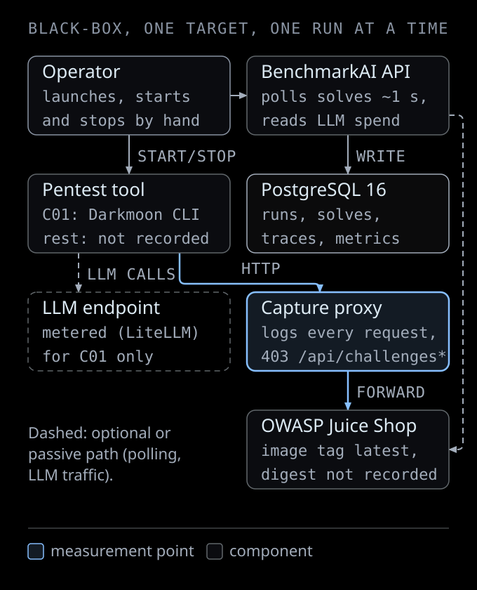
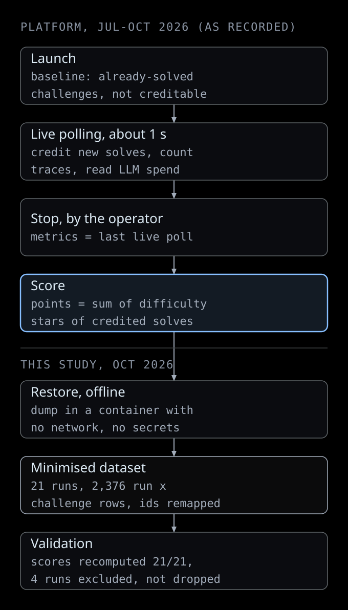
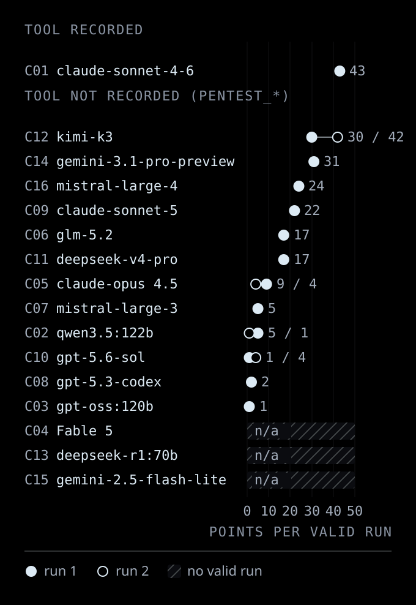
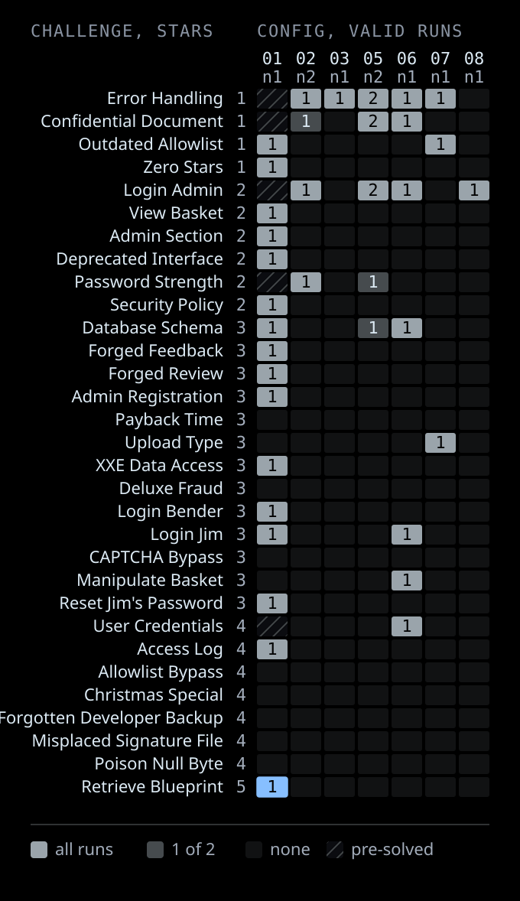
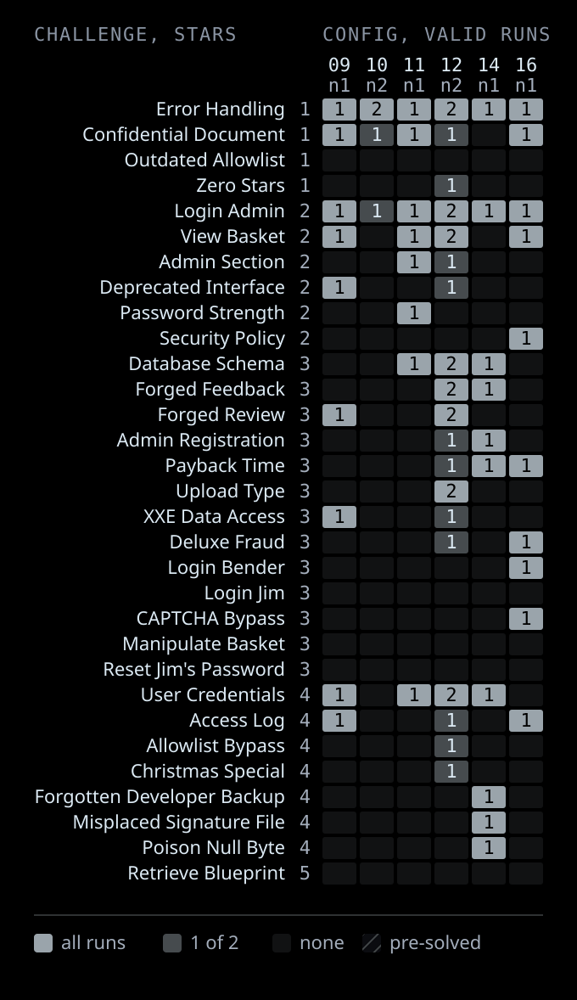
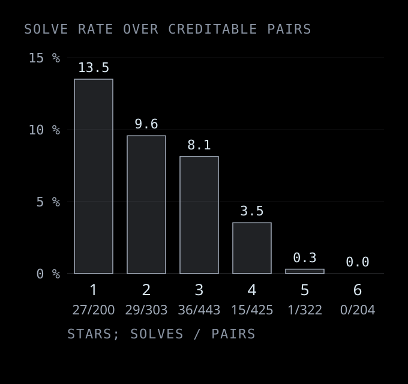
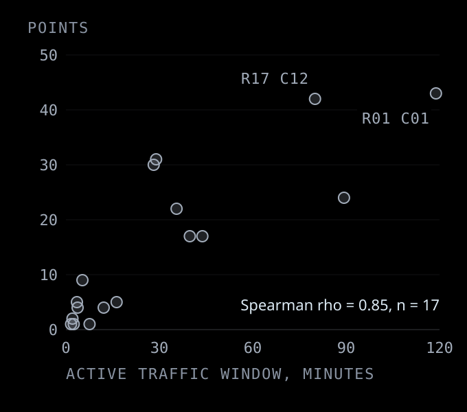
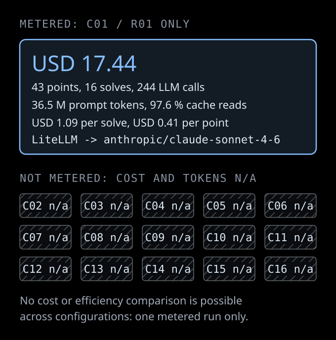
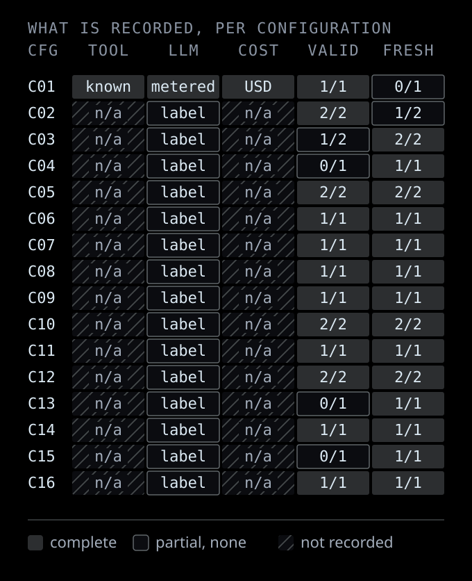

# LLM-driven pentest configurations on OWASP Juice Shop (BenchmarkAI, 2026)

**Study id:** `llm-pentest-juice-shop-2026` · **Runs:** 2026-07-01 to 2026-10-16 · **Published:** 2026-10-25 · **Data licence:** CC BY 4.0 · **Code licence:** GPL-3.0

> **Operator disclosure.** The BenchmarkAI platform, the target environment and every run in this study were built, launched and stopped by the Darkmoon team (ASC-IT). This is **not an independent benchmark**. Darkmoon is one of the tools in the data, and we have tried to report it with the same rules as every other configuration: no best-run selection, no run dropped for a low score, and every limitation stated below.

> **What a "result" is here.** Each row is a **configuration**: a pentest tool paired with an LLM label, as recorded by the platform. A result describes that pair, never the model alone. Only configuration **C01** records its tool (the Darkmoon open-source CLI at commit `130f6de`, LLM `claude-sonnet-4-6` through LiteLLM). Configurations **C02 to C16** are labelled `Pentest_<model>` in the database and **their tool is not recorded**: we do not know, and do not assume, whether they ran Darkmoon or any other tool.

## Contents

- [Research question](#research-question)
- [Scope](#scope)
- [Verified results](#verified-results)
- [Comparison table](#comparison-table)
- [Figures](#figures)
- [What these results do not show](#what-these-results-do-not-show)
- [Files](#files)
- [Related articles](#related-articles)
- [How to cite](#how-to-cite)

## Research question

On one public, deliberately vulnerable web application (OWASP Juice Shop), tested black-box through a logging proxy, **how many of the application's built-in challenges does an LLM-driven pentest configuration solve, how does that depend on challenge difficulty, and how stable is the result across repeated runs?**

Three secondary questions are asked only where the data allows: what a run costs in LLM tokens and money (one metered run), whether longer sessions score more (confounded, see limits), and which vulnerability categories are reached at all.

## Scope

| In scope | Out of scope |
|---|---|
| 21 runs recorded by BenchmarkAI between 2026-07-01 and 2026-10-16, restored from two backups of its PostgreSQL database | Any run deleted from the database before the backups (see [limitations](methodology/limitations.md#4-deleted-runs-selection-risk)) |
| One target: OWASP Juice Shop, Docker image tag `latest` (digest not recorded) | Other targets, white-box testing, false-positive or report quality |
| Score = sum of Juice Shop difficulty stars of challenges the application itself marks as solved | Severity, exploitability or business impact of findings |
| LLM tokens and cost where metered (run R01 only) | Cost of any other run (not recorded, never estimated) |
| Tool identity where recorded (C01 only) | Attribution of C02..C16 results to any named tool |

The full protocol is in [methodology/experimental-protocol.md](methodology/experimental-protocol.md), the scoring rules in [methodology/scoring-methodology.md](methodology/scoring-methodology.md), the software environment in [methodology/environment.md](methodology/environment.md) and the threats to validity in [methodology/limitations.md](methodology/limitations.md).

## Verified results

Every number below is recomputed from the published dataset by [`scripts/generate_tables.py`](scripts/generate_tables.py) and checked in CI by [`scripts/validate_results.py`](scripts/validate_results.py).

<!-- BEGIN GENERATED:headline -->
| Quantity | Value |
| --- | --- |
| Configurations found (tool x model label) | 16 |
| Runs found | 21 |
| Valid runs / configurations with a valid run | 17 / 13 |
| Excluded runs (no target traffic or aborted) | 4 |
| Configurations whose tool is recorded | 1 |
| Runs with metered tokens and cost | 1 |
| Distinct challenges solved at least once (valid runs) | 31 |
| Highest points in a single valid run | 43 of 394 catalogue points |
| Runs per configuration | 1 to 2 |
<!-- END GENERATED:headline -->

1. **Low ceiling.** No valid run reached 11 % of the catalogue's points. The two highest runs are R01 (C01, 43 points, 16 solves) and R17 (C12 `kimi-k3`, 42 points, 16 solves). R01 started on a target where 7 easy challenges were already solved and could not be credited, so the two runs are not directly comparable; with n = 1 and n = 2 runs we do not rank them.
2. **Difficulty gradient.** The solve rate falls monotonically with Juice Shop's difficulty rating, from 13.5 % of creditable 1-star pairs to 0.3 % at 5 stars and 0 % at 6 stars. One 5-star challenge was solved in the whole dataset (Retrieve Blueprint, R01); no 6-star challenge was solved.
3. **Categories.** Security Misconfiguration and Injection challenges are reached most often; no challenge in the XSS, Vulnerable Components, Cryptographic Issues, Insecure Deserialization or Security through Obscurity categories was solved in any valid run.
4. **Instability.** Repeated runs of the same configuration solve different challenges (Jaccard overlap 0.00 to 0.60 over the four configurations with two valid runs), so a single-run ranking is not reliable.
5. **Effort confound.** Points correlate with the active traffic window (Spearman rho 0.85 over 17 valid runs), but run length was decided by the operator who pressed Stop: several valid runs stopped in under 7 minutes. This is a design confound, not evidence that time causes points.
6. **Cost.** Only R01 was metered: USD 17.44 for 43 points (USD 1.09 per solved challenge), 36.5 million prompt tokens of which 97.6 % were cache reads. No cost comparison across configurations is possible.
7. **Reliability.** Three configurations (C04, C13, C15) produced no request to the target at all and one run of C03 was aborted after one request. These are reported as failed runs, never as a score of 0 for the model.

## Comparison table

All valid runs are listed (values separated by `/`, in run order); there is no best-run selection. Excluded runs keep their row and the reason. Cost is `n/a` where it was not metered.

<!-- BEGIN GENERATED:comparison -->
| Config | Tool (as recorded) | Model label (as recorded) | Valid / total runs | Solved | Points | Share of catalogue points | Active window (min) | HTTP requests | LLM cost | Status |
| --- | --- | --- | --- | --- | --- | --- | --- | --- | --- | --- |
| [C01](results/configs/C01.md) | Darkmoon OSS CLI @130f6de | `claude-sonnet-4-6` | 1 / 1 | 16 | 43 | 10.9 % | 118.8 | 7,886 | USD 17.44 | valid |
| [C02](results/configs/C02.md) | not recorded | `qwen3.5:122b` | 2 / 2 | 3 / 1 | 5 / 1 | 1.3 % / 0.2 % | 3.5 / 1.7 | 114 / 37 | n/a | valid |
| [C03](results/configs/C03.md) | not recorded | `gpt-oss:120b` | 1 / 2 | 1 | 1 | 0.2 % | 2.5 | 20 | n/a | 1 run excluded |
| [C04](results/configs/C04.md) | not recorded | `Fable 5` | 0 / 1 | excluded | excluded | excluded | excluded | 0 | n/a | excluded: no HTTP traffic reached the target through the capture proxy |
| [C05](results/configs/C05.md) | not recorded | `claude-opus 4.5` | 2 / 2 | 5 / 3 | 9 / 4 | 2.3 % / 1.0 % | 5.3 / 3.8 | 38 / 129 | n/a | valid |
| [C06](results/configs/C06.md) | not recorded | `glm-5.2` | 1 / 1 | 7 | 17 | 4.3 % | 39.8 | 1,714 | n/a | valid |
| [C07](results/configs/C07.md) | not recorded | `mistral-large-3` | 1 / 1 | 3 | 5 | 1.3 % | 16.3 | 365 | n/a | valid |
| [C08](results/configs/C08.md) | not recorded | `gpt-5.3-codex` | 1 / 1 | 1 | 2 | 0.5 % | 2.1 | 20 | n/a | valid |
| [C09](results/configs/C09.md) | not recorded | `claude-sonnet-5` | 1 / 1 | 9 | 22 | 5.6 % | 35.5 | 698 | n/a | valid |
| [C10](results/configs/C10.md) | not recorded | `gpt-5.6-sol` | 2 / 2 | 1 / 3 | 1 / 4 | 0.2 % / 1.0 % | 7.6 / 12.1 | 92 / 129 | n/a | valid |
| [C11](results/configs/C11.md) | not recorded | `deepseek-v4-pro` | 1 / 1 | 8 | 17 | 4.3 % | 43.8 | 1,080 | n/a | valid |
| [C12](results/configs/C12.md) | not recorded | `kimi-k3` | 2 / 2 | 11 / 16 | 30 / 42 | 7.6 % / 10.7 % | 28.2 / 80.0 | 98 / 590 | n/a | valid |
| [C13](results/configs/C13.md) | not recorded | `deepseek-r1:70b` | 0 / 1 | excluded | excluded | excluded | excluded | 0 | n/a | excluded: no HTTP traffic reached the target through the capture proxy |
| [C14](results/configs/C14.md) | not recorded | `gemini-3.1-pro-preview` | 1 / 1 | 10 | 31 | 7.9 % | 29.0 | 811 | n/a | valid |
| [C15](results/configs/C15.md) | not recorded | `gemini-2.5-flash-lite` | 0 / 1 | excluded | excluded | excluded | excluded | 0 | n/a | excluded: no HTTP traffic reached the target through the capture proxy |
| [C16](results/configs/C16.md) | not recorded | `mistral-large-4` | 1 / 1 | 10 | 24 | 6.0 % | 89.3 | 2,214 | n/a | valid |
<!-- END GENERATED:comparison -->

Per-configuration pages, including the excluded configurations, are in [results/configs/](results/configs/). The run-level table, difficulty, category, challenge and variability tables are in [results/global-comparison.md](results/global-comparison.md).

## Figures

All figures are generated from the dataset by [`diagrams/src/build_figures.py`](diagrams/src/build_figures.py) with the [diagram-design](https://github.com/cathrynlavery/diagram-design) skill and the Darkmoon skin. Missing data is hatched and labelled `n/a`, never drawn as zero.

**Figure 1. Experimental protocol.** The operator starts and stops the tool by hand; all target traffic passes a capture proxy; the platform polls Juice Shop for solved challenges.

**Figure 2. BenchmarkAI scoring and our extraction pipeline.**

**Figure 3. Points of every valid run, by configuration.** Configurations with two valid runs show both; three configurations have no valid run.

**Figure 4. Challenges solved, by configuration (two panels).** Cell = number of valid runs of the configuration that solved the challenge; hatched = already solved at launch, not creditable. The highlighted cell is the only 5-star solve.

**Figure 5. Difficulty gradient.**

**Figure 6. Time and performance.** Points against the active traffic window of each valid run (confounded by operator stop decisions).

**Figure 7. Cost and performance: what exists.** One metered run; the other 15 configurations have no cost data.

**Figure 8. Data availability map.**

## What these results do not show

- **They do not rank LLMs.** The tool is unknown for 15 of 16 configurations, so differences may come from the tool, its configuration, the prompt, the operator or the model.
- **They do not measure real-world pentest quality.** Juice Shop challenges are a proxy with author-assigned difficulty; findings outside the challenge list, false positives and report quality are not measured.
- **They are not statistically significant comparisons.** n is 1 or 2 per configuration and run lengths differ by more than an order of magnitude.
- **They do not validate any claim about other Darkmoon research** (WebXR visualization, PHP detection, WebGL performance).

## Files

| Path | Content |
|---|---|
| [datasets/](datasets/) | Public, minimised dataset: runs, run x challenge results, catalogue, aggregates, per-configuration files, manifest with field definitions and sha256 |
| [results/global-comparison.md](results/global-comparison.md) | All comparison tables |
| [results/configs/](results/configs/) | One page per configuration C01..C16 |
| [methodology/](methodology/) | Protocol, scoring, environment, limitations |
| [diagrams/](diagrams/) | SVG figures and their generated sources |
| [scripts/](scripts/) | Validation, table generation, provenance script |
| [reproducibility/README.md](reproducibility/README.md) | How to re-run the analysis and what cannot be reproduced |

## Related articles

- Study article on dark-moon.org: [LLM pentesting benchmark](https://dark-moon.org/blog/llm-pentesting-benchmark/) (French: [dark-moon.org/fr/blog/llm-pentesting-benchmark](https://dark-moon.org/fr/blog/llm-pentesting-benchmark/))
- Configuration article (C01) on dark-moon.org: [Claude Sonnet 4.6 pentest benchmark](https://dark-moon.org/blog/claude-sonnet-4-6-pentest-benchmark/), linked to [results/configs/C01.md](results/configs/C01.md)

## How to cite

See [`CITATION.cff`](../../CITATION.cff) at the repository root, or:

> Darkmoon team (ASC-IT). *LLM-driven pentest configurations on OWASP Juice Shop (BenchmarkAI, 2026).* Darkmoon-Benchmarks, study `llm-pentest-juice-shop-2026`, 2026. https://github.com/ASCIT31/Darkmoon-Benchmarks/tree/main/studies/llm-pentest-juice-shop-2026
